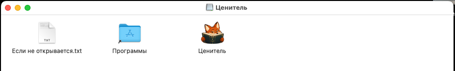
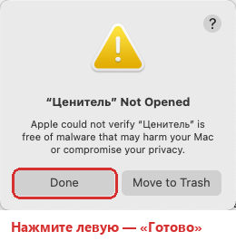
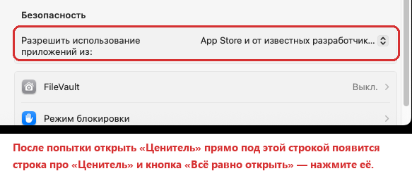

## Как установить

> **Не пугайтесь окон браузера.** «Ценитель» работает через ваш браузер: само окно программы — это окно браузера
> без вкладок и адресной строки, а когда вы ищете цены, программа сама открывает ещё одно окно — «Поиск цен» — и
> сама ходит в нём по магазинам и Авито. Так и задумано. Это отдельные окна со своим профилем: ваши вкладки,
> история и пароли не затрагиваются, а окно поиска закроется само, когда поиск закончится.

Нужен один из браузеров: **Google Chrome, Microsoft Edge или Яндекс Браузер** (подойдут и Brave, Vivaldi).
Программа сама находит установленный и открывает в нём свои отдельные окна со своим профилем — ваши окна,
вкладки и пароли она не трогает. Если подходящих браузеров несколько, нужный выбирается в программе: «Справка →
Браузер». Safari и Firefox программа не умеет: если на компьютере только они, без
одного из браузеров выше она работать не сможет — скачайте [Chrome](https://www.google.com/chrome/),
[Edge](https://www.microsoft.com/edge/download) или [Яндекс Браузер](https://browser.yandex.ru/).

### Windows 10 и 11

1. Скачайте `BookPrice-<версия>.zip` — внизу страницы выпуска, в разделе «Assets».
2. Создайте папку для программы, например «Документы\Ценитель». **Если на компьютере антивирус — сразу добавьте
   эту папку в его исключения** (как — ниже): иначе он может удалять файлы при распаковке и спрашивать про каждый.
3. Правой кнопкой по архиву → «Извлечь всё…» → выберите эту папку.
4. Откройте `BookPrice.exe`. Если Windows покажет «Система Windows защитила ваш компьютер» — «Подробнее» →
   «Выполнить в любом случае». Это один раз. На рабочем столе появится ярлык «Ценитель».

**Если ругается антивирус.** У программы нет платной цифровой подписи, а собрана она тем же инструментом, что и
многие небольшие программы, — антивирусы относятся к таким с подозрением. Вместо того чтобы разрешать каждое
срабатывание, один раз добавьте папку программы в исключения:

- **Защитник Windows**: «Пуск» → «Безопасность Windows» → «Защита от вирусов и угроз» → «Параметры защиты от
  вирусов и других угроз: Управление настройками» → внизу «Исключения: Добавление или удаление исключений» →
  «Добавить исключение» → «Папка» → папка программы. Если файл уже убран — там же, «Журнал защиты» → запись про
  BookPrice → «Действия» → «Восстановить» или «Разрешить на устройстве».
- **Касперский и другие**: в настройках найдите «Исключения» или «Доверенная зона» и добавьте папку программы.
- Если антивирус заговорит после обновления — добавьте так же папку данных: вставьте `%LOCALAPPDATA%\BookPrice`
  в адресную строку Проводника, чтобы её открыть.

### Mac (пробная версия)

Подходит любой Mac на macOS 12 или новее — и с процессором Intel, и с Apple M: программа одна. Выберите один из
двух способов. Оба делаются один раз — дальше программа обновляется сама.

#### Способ 1 — одной строкой (проще всего, 2 минуты)

Терминал — обычная программа Mac, в которую пишут команды. Здесь понадобится только вставить в неё одну строку —
ничего настраивать и понимать не нужно.

1. Нажмите на клавиатуре **⌘ Command и Пробел** одновременно — посреди экрана появится строка поиска.
2. Напечатайте **Терминал** и нажмите **Enter**. Откроется окошко с текстом.
3. Скопируйте строку ниже — проще всего значком «копировать» справа от неё:

   ```
   curl -fsSL https://raw.githubusercontent.com/AlexLion89/book-price/main/tools/mac/install.sh | bash
   ```

4. Щёлкните в окошко Терминала, вставьте строку (**⌘ Command + V**) и нажмите **Enter**.
5. Подождите минуту-две: Терминал сам скачает «Ценитель», положит его в «Программы» и откроет. В конце он
   напишет «Готово!». Окно Терминала после этого можно закрыть.

Пароль не нужен, настройки безопасности — тоже: так программа ставится без вопросов macOS. Дальше «Ценитель»
открывается как обычно — из Launchpad или Finder → «Программы».

#### Способ 2 — скачать и разрешить в настройках (без Терминала)

1. Скачайте `BookPrice-<версия>-mac.dmg` — внизу страницы выпуска, в разделе «Assets» — и откройте его двойным
   щелчком. Откроется окно:

   

2. Перетащите лису **«Ценитель»** на папку **«Программы»**.
3. Откройте «Ценитель» — из Launchpad или Finder → «Программы». В первый раз Mac его не откроет и покажет
   окно с жёлтым треугольником: программа не открыта, Apple не удалось её проверить. Так бывает со всеми
   программами без платной подписи Apple. Нажмите **«Готово»** (левая кнопка, не «Переместить в Корзину»):

   

4. Откройте меню Apple (яблоко в левом верхнем углу) → **«Системные настройки»** → **«Конфиденциальность и
   безопасность»** и пролистайте вниз, до раздела **«Безопасность»**. Там будет строка про «Ценитель» и кнопка
   **«Всё равно открыть»** — нажмите её:

   

5. Mac спросит ещё раз — нажмите **«Открыть»** и введите пароль, которым входите в Mac. Готово: дальше
   «Ценитель» открывается обычным щелчком.

На **macOS 12–14** всё проще: в «Программах» щёлкните по «Ценителю» правой кнопкой (или с нажатой Control) →
**«Открыть»** → **«Открыть»**.

**Если Mac спросит «Разрешить приложению «Ценитель» находить устройства в локальных сетях?»** — нажмите
**«Не разрешать»**. Это macOS спрашивает про браузер, который открыла программа: браузеры сами ищут дома телевизоры
и колонки. Программе ни устройства, ни домашняя сеть не нужны — работать она будет так же.

Уже скачали `.dmg`, но не хотите в настройки? В Терминале (как в способе 1) вставьте строку
`xattr -dr com.apple.quarantine "/Applications/Ценитель.app"` и нажмите Enter — после этого «Ценитель» откроется
без вопросов. То же написано в файле «Если не открывается.txt» в окне образа.

Отчёт об ошибке и проверка площадок на Mac не кладутся на рабочий стол (macOS спросила бы на это разрешение):
программа сама откроет Finder с готовым файлом.
